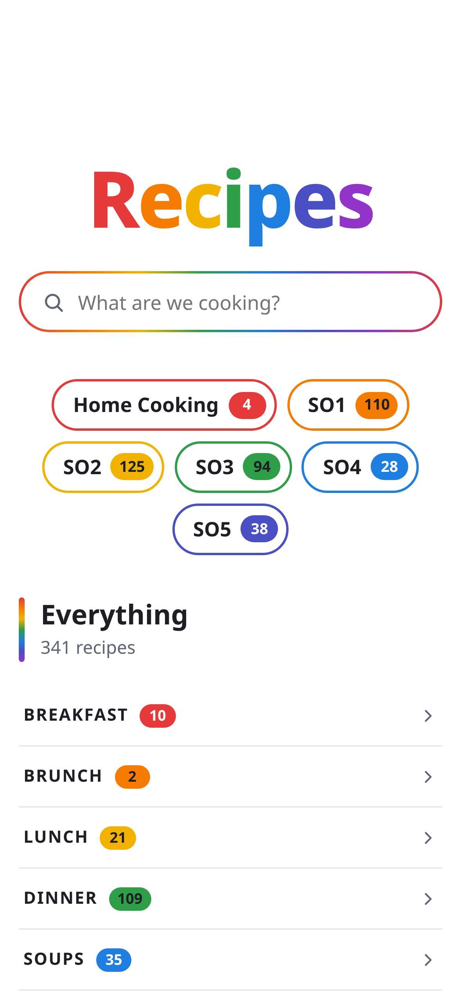
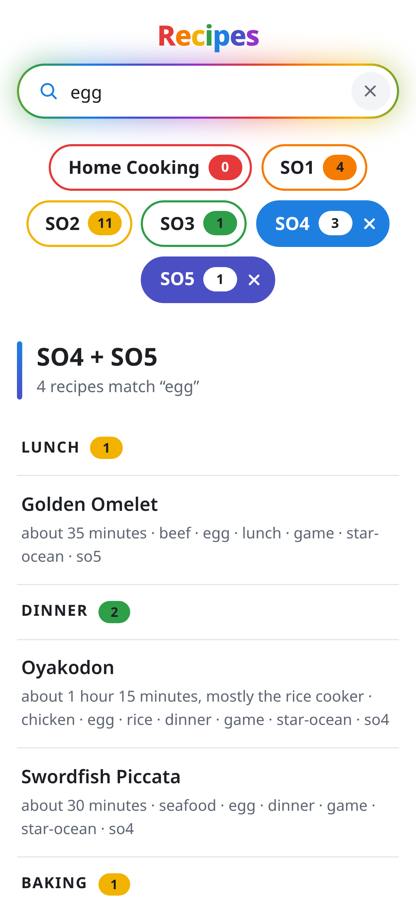

# Recipes

A small cookbook website that runs on your own computer, made for reading on your phone in the middle of
cooking. It has a search box, shelves for your recipes, and one clean page per recipe, where you tap to
check off ingredients and steps, make the recipe bigger or smaller, switch to metric, tap any time in a step
to start a timer, and get a confetti party when you finish. No ads, no life stories, just the recipe.

<p>
  <picture>
    <source media="(prefers-color-scheme: dark)" srcset="docs/screenshots/home-dark.png">
    
  </picture>
  <picture>
    <source media="(prefers-color-scheme: dark)" srcset="docs/screenshots/search-dark.png">
    
  </picture>
</p>

Your recipes are plain text files, one per recipe, in a folder you choose. It comes with six to start from,
all dishes from the Star Ocean games.

## Get it running

Download the zip for your computer from the [latest release](https://github.com/je-can-code/recipes/releases/latest)
and unzip it anywhere.

| Computer | Download |
|---|---|
| A Mac with Apple's own chip (M1 or newer) | `recipes-<version>-mac.zip` |
| Windows | `recipes-<version>-windows.zip` |
| Linux | `recipes-<version>-linux.zip` |

Inside is the program, its settings in `config.yaml`, a `recipe-cards` folder with the six starter recipes,
and `START-HERE.txt`, a short version of what follows.

### Mac

1. Double-click `recipes`. The first time, macOS stops it, because it doesn't come from the App Store or a
   developer Apple knows. Click **Done**, open **System Settings**, go to **Privacy & Security**, scroll
   down, and click **Open Anyway** beside the note about recipes. Double-click it again and choose **Open**.

   If you'd rather use Terminal: type `xattr -dr com.apple.quarantine ` (with the space at the end), drag
   the unzipped folder onto the window, press Return, then double-click `recipes`.
2. A Terminal window opens and shows where to open the site, like `http://localhost:8686`. Keep the window
   open while you use it, since closing it stops the site.

On a Mac with an Intel chip, [build it yourself](#building-it-yourself).

### Windows

1. Double-click `recipes.exe`. If Windows says **Windows protected your PC**, click **More info**, then
   **Run anyway**. It says that because the program isn't signed. If Windows asks whether to let it use
   your networks, allow **private networks**, so your phone can reach it.
2. A window opens and shows where to open the site, like `http://localhost:8686`. Keep the window open
   while you use it, since closing it stops the site.

### Linux

1. In a terminal, in the unzipped folder, run `./recipes`.
2. It shows where to open the site, like `http://localhost:8686`. Keep it running while you use it, or
   [keep it on all the time](#always-on-on-linux).

## On your phone

With the site running, open the other address it shows, like `http://192.168.1.23:8686`, on any phone or
tablet on the same Wi-Fi. On an iPhone or iPad, tap **Share**, then **Add to Home Screen**, to open it like
an app.

### Optional: https, for offline and a screen that stays on

Over plain http, a phone can't keep its own copy of the site, so it only opens on your Wi-Fi, and the screen
dims mid-recipe as usual. With https, a phone keeps its own copy, so after one visit at home the site opens
anywhere, and the screen stays on while you cook. It takes a few minutes, once:

1. In `config.yaml`, delete the `#` at the start of the `certificates` and `listenSecure` lines.
2. Run the certs command once, from the unzipped folder:
   - **Mac:** open Terminal, type `cd ` (with the space), drag the folder onto the window, press Return,
     then run `./recipes certs`.
   - **Windows:** click the folder window's address bar, type `cmd` and press Enter, then run
     `recipes.exe certs` in the window that opens.
   - **Linux:** run `./recipes certs` in the folder.
3. Start the site again. It now shows `https://` addresses, and a trust address ending in `/trust`.
4. On each phone or tablet, open the trust address once and follow the steps for that kind of device.

The certificate covers your computer's address on the network. If your router ever hands your computer a
new one, run the certs command again and start the site again; phones don't need to trust anything new. The
`certs` folder holds the private key that every trusting device believes, so keep it to yourself.

## Your own recipes

Each recipe is a YAML file in the cards folder. `recipe-cards/_template.yaml` explains every field, and the
starter cards show what finished ones look like. A new or changed card shows up the next time the page
loads, with no restart.

A card can offer other batch sizes, from a quarter to four times, once it's written for them: see "A card
that scales" in [`docs/writing-cards.md`](docs/writing-cards.md).

To keep your recipes somewhere else, point `recipesFolder` in `config.yaml` at that folder. It can be
anywhere: your Documents folder, a synced folder, another drive.

To find mistakes in your cards, run the check command the same way as the certs command above: `./recipes
check`, or `recipes.exe check` on Windows. It names every card with a problem and says what to fix. The site
shows the same list in a red banner.

### Shelves

The home page sorts recipes onto shelves, with a rainbow chip for each:

- **A collection** gets a shelf from an entry in `_collections.yaml` in the cards folder: a tag, a label
  for its chip, and a full name. Every recipe carrying that tag is on its shelf, so a recipe can be in
  several. Group them any way that suits you: by game, by cuisine, by season. The starter recipes come in
  five collections, one per Star Ocean game, through their tags `so1` to `so5`.
- **Home Cooking** holds every recipe that isn't in any collection, so a card never goes missing from the
  home page.

Cards can also sit in folders inside the cards folder, one level deep, just to keep things tidy. A folder
doesn't make a shelf.

Tap chips to combine shelves, and tap a lit chip again to put it out. With none lit, everything shows.
Search narrows whatever is showing, and each chip shows how many of its recipes match.

## Settings

`config.yaml` sits next to the program, which reads it when it starts. To keep it somewhere else, start the
program with `-config path/to/config.yaml`.

| Setting | What it does |
|---|---|
| `recipesFolder` | Where the cards live. A relative path is read from the config's own folder. |
| `listen` | The address plain http listens on. `0.0.0.0:8686` lets other devices on the network reach it, on port 8686. |
| `certificates` | The folder the certs command keeps the certificates in. Without it, the site is plain http only. |
| `listenSecure` | The address https listens on, like `0.0.0.0:8443`. |
| `name` | Linux only: a name for the site on the Wi-Fi, like `recipes.local`. One word, then `.local`. |

## Always on, on Linux

To have the site start with the computer and run with nobody logged in, unzip the download into a folder
named `recipes` in your home folder, then install the service in [`service/recipes.service`](service/recipes.service):

```bash
cp recipes.service ~/.config/systemd/user/
systemctl --user daemon-reload
systemctl --user enable --now recipes
loginctl enable-linger "$USER"
```

If the program is somewhere else, change the path on its `ExecStart` line first. To use ports 80 and 443,
so the addresses need no port number, Linux has to let ordinary programs use them:

```bash
echo 'net.ipv4.ip_unprivileged_port_start=80' | sudo tee /etc/sysctl.d/60-recipes-port-80.conf
sudo sysctl -p /etc/sysctl.d/60-recipes-port-80.conf
```

Looking after it:

```bash
systemctl --user status recipes     # is it up?
systemctl --user restart recipes    # restart it
journalctl --user -u recipes -f     # its output, as it happens
```

## Building it yourself

You need [Bun](https://bun.sh) and [Go](https://go.dev). The downloads come from the same command:

```bash
bun install
bun run release        # the three zips, in release/
```

For a computer without a download, like an Intel Mac or a Raspberry Pi, build the program for it directly,
then put the starter cards and `config.example.yaml` (renamed `config.yaml`) beside it:

```bash
bunx --bun vite build && bun scripts/build-worker.ts
cd server && GOOS=darwin GOARCH=amd64 CGO_ENABLED=0 go build -o recipes ./cmd/recipes
```

`GOOS=linux GOARCH=arm64` is the one for a Raspberry Pi running a 64-bit system.

---

# How it works

The rest is for working on the code.

## Working on the code

Copy `config.example.yaml` to `config.yaml` and point `recipesFolder` at some cards, like `starter-recipes`.
`config.yaml` is each machine's own, so git leaves it out.

| Command | What it does |
|---|---|
| `bun run dev` | Go on port 8686 and Vite on 5173. Open `http://localhost:5173`, and pages reload as you edit. An always-on copy on other ports keeps running alongside. |
| `bun run build` | Typechecks, builds the website and its service worker into the server, then builds `bin/recipes` with git's name for the commit written in as its version, like `v1.1.0`. |
| `bun run deploy` | Builds everything, then restarts the [always-on service](#always-on-on-linux) so it runs the new build. |
| `bun run start` | Runs `bin/recipes` by hand with `config.yaml`. Stop the service first if it uses the same ports. |
| `bun run check` | Reads every card and lists every problem. Exits 1 if there are any. |
| `bun run certs` | Makes the https certificates the first time, and renews the site's certificate after that. |
| `bun run test` | The website's tests, then the server's. |
| `bun run release` | Builds the website, then the three downloads into `release/`. |

Cards reload on their own: save one and the next page load shows it. Code doesn't, so after changing it,
build again and restart.

## How a page gets to the screen

1. **The cards are YAML files on disk**, one per recipe. `_template.yaml` in the cards folder defines the
   format, and `_collections.yaml` beside it lists the collections that get shelves.
2. **The Go server reads them** (`server/internal/cards`). It decodes each card strictly, checks it
   against the format's rules, renders its markdown to HTML, points links between recipes at their
   pages, and turns the braces in its steps into spans the page can scale. Anything wrong becomes a
   problem naming the file and saying what to fix, and every good card still loads.
3. **It serves them as JSON** (`server/internal/api`). `GET /api/recipes` lists every recipe along with
   the collections and every problem, and `GET /api/recipes/{name}` returns one recipe, ready to show.
4. **The website is a React app** (`web/`), built once into `server/internal/site/dist` and baked into
   the Go program. Any address that isn't a file or under `/api` gets the app's page, and the app decides
   what that address shows.
5. **The browser does the rest.** The app fetches the JSON and draws the page. Search runs in the
   browser over the list it already has, which is why it keeps up with every keystroke.
6. **A service worker stands in between** on every device. It passes each request to the server and
   saves what comes back, and answers from that copy when the server can't be reached. See
   [Away from home](#away-from-home).

The server compares the cards' sizes and modified times on every request, and reads the folder again
when anything changed. A new or edited card shows up on the next page load, without a restart.

## Cooking from a recipe

A recipe page is built to cook along with, not just to read:

- **Tap to check things off.** An ingredient gets ticked and turns bold, since it's on the counter and still
  has to be read as the steps call for it; a step fades back with a tick in its number. The next step to
  do waits in a highlighted card with its number glowing.
- **The quest tracker** is pinned to the bottom: the next step's lead (tap it to scroll there), a rainbow
  bar that fills as steps get done, and a way to start over. Finishing the last step throws a confetti
  party, once; reopening a finished recipe just shows it finished.
- **Every time in the method is a timer.** "8 to 10 minutes" becomes a button, and tapping it starts a
  countdown for the low end of the range, named after its step. Running timers ride along in the tracker,
  soonest first, and chime when they're done, whichever page is open. Off a recipe's page, a dock at the
  bottom shows them, each one leading back to its recipe.
- **Make it bigger or smaller.** A card written for it gets a row of batch sizes under its serving line,
  from ¼× to 4×. Every amount follows, including the ones a step points at, and the serving line does the
  math. A size that would split an egg is greyed out, and times never change.
- **US or metric.** The switch beside it shows milliliters, grams, °C and centimeters instead, keeping
  teaspoons, tablespoons and rice cooker cups, which are the same size in Japan.
- **On a tablet**, the ingredients get a column of their own that stays put while the steps scroll.

All of it is kept in the browser, in localStorage, so a reload or a trip to another page picks up where the
cook left off. Progress and the batch size are kept per recipe and go stale after a day, the measuring system
is one choice for the whole site, and a timer is forgotten an hour after it rang. Nothing about cooking
reaches the server, and nothing in it changes the cards.

**The screen stays on mid-cook**, from the first checkmark to the last step or while a timer runs, and the
tracker says "screen on" while it does. That's the Screen Wake Lock API, which browsers only allow on secure
pages, which is why https matters. It also keeps timers honest: a phone that locks pauses the page, so a
timer that ends while it's locked can only chime once the phone is unlocked. An older device without the
API just dims as usual.

## Shelves, search and the address

The home page's shelves are Home Cooking, which holds every recipe in no collection, then each collection in
`_collections.yaml`'s order, holding every recipe with its tag. `check` reports a mistake in the collections
file. A folder only keeps cards tidy: cards are read at the top level and one folder down, and a folder
makes no shelf.

The list is split into courses, Breakfast through Drinks, each recipe once. A recipe tagged with two
courses goes under the more particular kind of dish, so a ramen tagged dinner and soup is with the soups,
and one with no course tag at all goes under Everything else. Each course is an accordion, closed until
it's tapped. The open ones are remembered while the site stays open, so coming back from a recipe finds the
page as it was, scroll included.

Search narrows whatever the lit chips show, as the typing goes, and each chip's number becomes its count of
matches. During a search, every course with a match shows open. Once something is typed, the top of the
page shrinks, so the results sit above a phone's keyboard. When the lit chips have nothing that matches, a
link offers the same search over everything. Search looks at each recipe's title, tags and folder.
Every word has to match, and words match partway through, so `beef dinner` finds recipes that are both,
and `chori` already finds the chorizo.

The address holds the lit chips and the search (`/?shelf=so4&shelf=so5&q=egg`), so the back button and a
shared link land on the same list. A recipe's tags link to a search for that tag, and an address under
`/search?q=` goes to the same search on the home page.

## https

Browsers only treat a page as secure when they trust whoever signed its certificate, and no public
authority signs for a computer on a home network. So the site has a certificate authority of its own
(`server/internal/certs`), which signs the site's certificate, and each device trusts that authority once.

- **The certs command** makes the authority the first time (`certs/ca.crt` and `certs/ca.key`), then
  issues the site's certificate (`certs/site.crt` and `certs/site.key`) for the site's name, the
  computer's `.local` name, `localhost`, and the computer's addresses on its networks. Restart the site to
  pick up a new one.
- **Plain http stays up beside https** (`server/internal/trust`). It sends every visit on to the same
  page on https, except for the two things a device needs before it can open https at all: the trust
  page at `/trust`, and the authority to download at `/ca.crt`. The redirect is temporary on purpose:
  browsers keep permanent ones forever, and if https ever broke, they'd lock plain http away too.
- **Adding a device:** open the trust page on it and follow the steps for that kind of device. On an
  iPhone or iPad that's installing a profile, then turning it on under Certificate Trust Settings. Until
  then, that device gets a warning on https.
- **Renewing:** Apple won't accept a certificate from a self-made authority that lasts longer than 825
  days, so the site's lasts 800. The site says when it runs out each time it starts. Run the certs command
  and restart before then. The authority itself lasts ten years and is kept across renewals, so no device
  ever has to trust anything new.
- **The authority's private key is the one secret here.** A device that trusts the authority would believe
  any certificate it signs, for any website, so `certs/ca.key` is readable only by its owner, is ignored by
  git, can never go into a download (the release build refuses), and never leaves the computer that made it.

Development (`bun run dev`) listens on loopback and stays on plain http.

## How phones find a .local name

Names ending in `.local` aren't looked up in DNS. A phone asks the whole Wi-Fi "who's recipes.local?", and
Avahi, the program that answers for a Linux computer's own `.local` name, answers with the computer's
address. With `name` set, the server asks Avahi to do that once it's listening (`server/internal/announce`),
and checks every 10 seconds that Avahi still is, so the name comes back by itself after a reboot, an Avahi
restart or a new address from the router. When the server stops, Avahi stops answering. Avahi is Linux's,
so on a Mac or Windows the site goes by the computer's address instead.

Only a server other devices can reach announces the name. `bun run dev` listens on `127.0.0.1`, so it
never claims the name an always-on copy holds. The service's log (`journalctl --user -u recipes`) says
when the name is announced, and what went wrong if it can't be.

## Away from home

The site only exists on the home Wi-Fi, so anywhere else a phone can't reach the computer running it. With
https, the site opens anyway, because every device keeps its own copy of the app and every recipe.

- **A service worker keeps the copy** (`web/src/worker`). It's the part of a site that a browser keeps on
  the device and runs by itself, between the page and the network. A build's files are saved the first
  time the build loads, and the catalog and every recipe are saved beside them, so any recipe opens
  anywhere, even one that was never opened at home.
- **The computer goes first.** A page, the catalog or a recipe comes from the computer when it answers
  within two seconds, and is saved for later. When it doesn't, the saved copy answers, and for the next
  five minutes the copy answers straight away, so only the first tap away from home has to wait. The
  computer is still asked behind every answer, and as soon as it replies, everything comes from it again.
- **Opening the list refreshes every saved recipe**, at most once a minute, and forgets the ones whose
  cards are gone. Checkmarks and timers already live on the device, so cooking needs nothing from the
  computer.
- **New builds reach devices by themselves.** `scripts/build-worker.ts` names each build after its
  contents and writes that name into `sw.js`. Browsers check `sw.js` whenever the site opens, and a changed
  one installs the new build and deletes the old one's files. A rebuild that changed nothing keeps its name,
  so devices have nothing to download.
- **A recipe that was never saved**, like one added while the device was away, says so instead of
  showing a blank page.

Development (`bun run dev`) has no service worker, since a copy there would get in the way of Vite
reloading the pages.

**On an iPhone or iPad, open it from the Home Screen.** Open the site's https address in Safari, tap Share,
then Add to Home Screen, and leave Open as Web App on. Open it once at home, and from then on it opens
anywhere. That matters for two reasons. Safari clears a website's saved data once about a week of browsing
has gone by without a visit, but a Home Screen web app only counts the days it's actually used, so its copy
stays. And other iPhone browsers may not run service workers in their tabs at all. The Home Screen app
keeps its own checkmarks and timers, apart from the browser's.

## Releases

Two GitHub Actions workflows live in `.github/workflows`:

- **`tests.yaml`** runs on every push to `main` and every pull request: the typecheck, both test suites, then
  the Linux download, unzipped and checked the way someone who downloads it would run it.
- **`release.yaml`** runs when a version tag is pushed. It runs the tests first, then builds the three
  downloads and attaches them to a new release named after the tag, with notes listing what changed.

```bash
git tag v1.0.0
git push origin v1.0.0
```

The downloads come from `server/cmd/release`, the same thing `bun run release` runs. It builds the program
for each computer, writes the version into it, and zips it with `config.example.yaml` as `config.yaml`, the
cards in `starter-recipes` as `recipe-cards`, and a note on getting started. It refuses any zip that would
carry a private key or anything from a `certs` folder.

## Where things live

| Path | What it is |
|---|---|
| `server/cmd/recipes` | The program, with its commands: `serve` (the default), `check`, `certs` and `version` |
| `server/cmd/release` | Builds the downloads for a release |
| `server/internal/cards` | Reading, checking and rendering the cards, and reading the collections file |
| `server/internal/api` | The JSON API, and routing everything else to the website |
| `server/internal/site` | Serving the built website from inside the program |
| `server/internal/config` | Reading `config.yaml` |
| `server/internal/announce` | Getting Avahi to answer for the site's name on the Wi-Fi |
| `server/internal/certs` | Making the certificate authority and the site's certificate |
| `server/internal/trust` | The plain-http side: the trust page, the authority download, and the redirect to https |
| `starter-recipes/` | The six cards, the template and the collections file every download starts with |
| `config.example.yaml` | The settings every download starts with, and the place to start your own `config.yaml` |
| `certs/` | This computer's certificates and the authority's private key, kept out of git |
| `docs/writing-cards.md` | How a card should read, beyond what `_template.yaml` defines: the voice, the kitchen and tastes the cards are written for, and how to write a batch of them |
| `docs/screenshots/` | The pictures at the top of this page |
| `service/recipes.service` | The always-on service, copied into `~/.config/systemd/user/` |
| `.github/workflows/` | The tests on every push, and the release on every version tag |
| `scripts/app-icon.html` | The home-screen icon, which the PNGs in `web/public` are screenshots of |
| `scripts/build-worker.ts` | Builds the service worker into the site as `sw.js`, after Vite has built the rest, with the build's name and file list written in |
| `scripts/build-server.ts` | Builds the program into `bin/recipes`, with git's name for the commit written in as its version, or `dev` without git |
| `web/src/worker` | The service worker. `policy.ts` and `strategies.ts` decide what's saved and when the copy answers, as plain tested functions, and `sw.ts` connects them to the browser. `tsconfig.worker.json` checks it against a worker's globals rather than a page's |
| `web/src/services` | Search, shelves, courses and the home page's address, link handling, the API client, installing the service worker, and everything cooking runs on (progress, timers and finding times in a step, batch sizes and metric in `amounts.ts` and `measures.ts`, the tracker's words, confetti physics, the chime), as plain tested functions |
| `web/src/hooks` | The glue between those services and the browser: loading a recipe, saving progress, running the site's timers, remembering the batch size and measuring system, the screen wake lock, remembering which courses are open |
| `web/src/pages`, `web/src/components` | The pages and their pieces, kept free of logic. `CookingRecipe` puts a recipe, its tracker and its confetti together, and `TimersProvider` runs the timers around the whole app |
| `web/test` | The website's tests |

## License

MIT. See [LICENSE](LICENSE).
